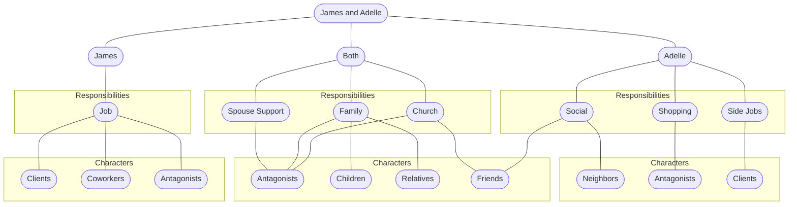
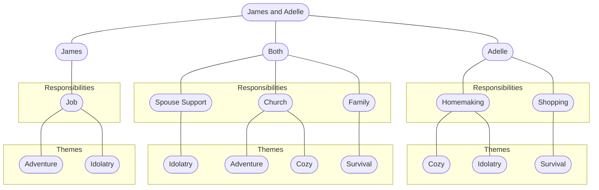

# Overview

- The purpose of this diagram is to visualize how the story can start from a focal point of the marriage between James and Adelle, and from there branch out into all the other interesting things I want to write about
- These designs play on James being the introvert and Adelle being the extrovert
  - In other words: James has a hard time relating to the world outside of his work, while Adelle has a more diverse set of relationships
- With reversed personalities the social aspects of these diagrams would be flipped, though James and Adelle's selected personalities match the average marriage dynamics a little better because women tend to be better at communal socialization
- Note that these graphs are only highlighting predominant relationships—many more fainter connections could be made between the nodes in these graphs

# Relation to characters

# Relation to themes

# Child pages
